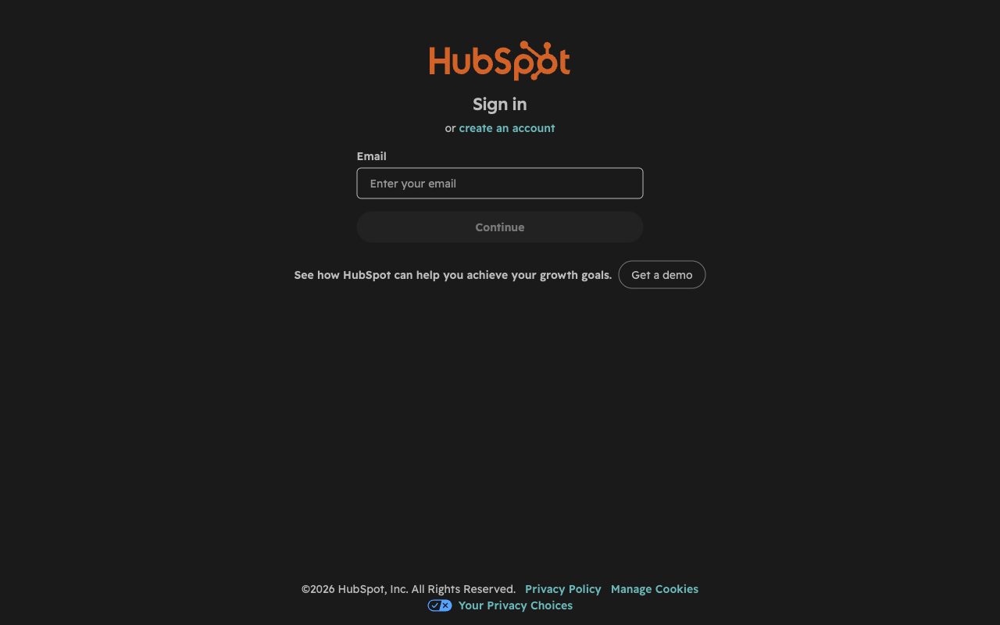

# Dark Mode for HubSpot

A free, open source Chrome extension that puts the HubSpot web app in dark mode.
It works in Chrome and in other Chromium browsers (Dia, Arc, Edge, Brave).

Not affiliated with HubSpot.

## Install

**From the Chrome Web Store:** link coming soon.

**From source:**
1. Download or clone this repo.
2. Open `chrome://extensions` (in Dia, use the Extensions menu if that URL does not open).
3. Turn on **Developer mode**.
4. Click **Load unpacked** and select this folder.

## Use

- Click the toolbar icon to turn dark mode on or off.
- Or press **Alt+Shift+D** (Option+Shift+D on Mac). To change the key, open `chrome://extensions/shortcuts`.
- The setting applies to all HubSpot tabs. The icon shows an "off" badge when dark mode is off.

## How it works

The extension inverts the page colors with a CSS filter. Then it inverts images, video and canvas again, so photos and logos keep their real colors.
The background is dark gray (`#1a1a1a`), not pure black.

It runs only on `app.hubspot.com` and the regional app domains (`app-eu1`, `app-na2`, `app-na3`, `app-ap1`).
It uses one permission, `storage`, to save the on/off setting.

## Known limits

- Images inside iframes (for example, email previews) show with inverted colors.
- Avatars set as a CSS background image show with inverted colors.
- Charts and illustrations change shade.
- When dark mode is off, a page shows dark for a moment while it loads.

Found a screen that looks wrong? Open an issue with a screenshot.

## Privacy

The extension collects no data. See [PRIVACY.md](PRIVACY.md).

## License

[MIT](LICENSE)
